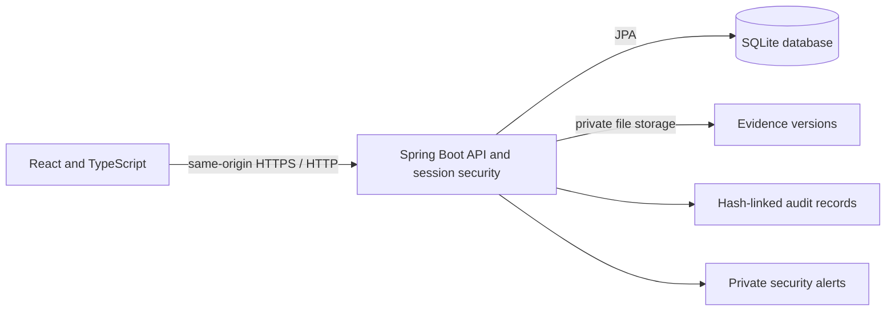

# CyberTrace

**Secure Evidence. Verify Integrity. Maintain Trust.**

CyberTrace is a student digital-forensics application for registering case evidence, checking file integrity with server-side SHA-256, tracking custody handovers, and preserving an application audit trail. It extends the existing Spring Boot, SQLite, and React project in this folder.

> **Educational project only.** Do not use it to store real law-enforcement, court, or personal records. Its database-backed audit chain and local file storage are not a certified evidence vault or an independently immutable archive.

## Features

- One-time, setup-key-protected first administrator creation; later public accounts are read-only external reviewers.
- Admin-created accounts with `ADMIN`, `INVESTIGATOR`, `LAWYER`, `COURT`, `AUDITOR`, and `RECIPIENT` roles. `INVESTIGATOR` is the existing project role name for an investigating officer.
- Server-side case-level access checks for evidence, downloads, notes, reports, and custody actions.
- Real evidence upload only to a case the submitting account can access, private storage, SHA-256 hashing on the server, verification against the currently authorized version hash, and preservation of the original reference hash.
- Corrected evidence stored as a new version; previous file bytes and version hashes are retained.
- Custody transfers remain pending until the named recipient accepts or rejects them. A transfer records its reason, notes, evidence version, and hash.
- Case activity and judicial notes, integrity history, private owner/admin security alerts, CSV reports, and a SHA-256-linked audit log with a verification action.
- Background file checks every 30 seconds after startup. A changed or missing active file generates a verification event, audit record, and private alert when detected.
- Server sessions use HttpOnly cookies; unsafe browser requests require a CSRF token. Passwords are stored as BCrypt hashes, not plain text or browser local storage.

## Technology and request flow

- Java 17, Spring Boot 3.5, Spring Security, Spring Data JPA
- SQLite through the Hibernate community SQLite dialect
- React, TypeScript, Vite, React Router
- Docker Compose for local container use; Render Blueprint for the public demonstration configuration



## Folder structure

```text
TraceA.S/
├── backend/                 Spring Boot application and tests
│   └── src/main/java/edu/cybertrace/
├── frontend/                React and TypeScript application
├── database/                Local SQLite database (ignored by Git)
├── storage/evidence/        Local private uploaded evidence (ignored by Git)
├── docs/VIVA_GUIDE.md        Source map and demonstration walkthrough
├── Dockerfile               Single-service production build
├── docker-compose.yml       Local container setup
└── render.yaml              Render public-host blueprint and persistent disk
```

## Database records

Hibernate creates and updates these tables at startup (`spring.jpa.hibernate.ddl-auto=update`):

| Table | Purpose |
|---|---|
| `users` | Username, BCrypt password hash, approved role, active state |
| `system_settings` | One-way record that initial admin setup has completed |
| `cases` / `case_shares` | Case assignment, dates, status, and explicit read access |
| `case_notes` | Append-only investigation and judicial-review notes |
| `evidence` | Metadata, current storage reference, original SHA-256 reference, integrity status |
| `evidence_versions` | Each stored version's file name, SHA-256, actor, reason, and time |
| `custody` | Pending/accepted/rejected transfer, custodians, reason, version, and hash |
| `verifications` | Actor, time, original reference, active-version hash, observed hash, and result |
| `audits` | Actor, action, outcome, details, previous hash, and event hash |
| `alerts` | Severity, evidence, actor, owner, timestamp, and read state |

`database/cybertrace.db` is used for local startup. The evidence files are kept under `storage/evidence`, outside the React public folder. Public Render configuration stores both under its persistent disk at `/app/data`.

## Roles and permission summary

| Role | Main permissions |
|---|---|
| `ADMIN` | Create/deactivate accounts, assign roles, oversee cases/evidence, review alerts/audits, export reports. Normal APIs cannot erase evidence or rewrite original reference hashes. |
| `LAWYER` | Submit evidence to cases they can access, update their own permitted submission metadata, and add corrected versions. |
| `INVESTIGATOR` | View assigned/shared cases, update case status/dates, add investigation notes, verify integrity, and request or accept assigned custody transfers. Does not replace submitted file bytes. |
| `COURT` | View explicitly shared cases/evidence, download permitted files, add separate judicial notes, and inspect integrity/custody history. |
| `AUDITOR` | Verify the audit chain and export reports; evidence is visible only when the auditor has case access. |
| `RECIPIENT` | Read-only access to cases explicitly shared with that account. This is the role given to public self-registration after bootstrap. |

The backend is the authority for access checks. React hides some unavailable controls for clarity, but protected API calls are checked again on the server.

## SHA-256, versions, and custody

1. The browser uploads file bytes to `POST /api/evidence`; it does not calculate the trusted hash.
2. Spring writes a randomly named file in the private evidence directory and calculates SHA-256 from the stored bytes.
3. The first hash is stored in `evidence.referenceHash`; that entity field is marked non-updatable by JPA. The first file and its version row remain on disk.
4. A correction creates another uniquely named file and an `evidence_versions` row. The original hash remains unchanged. Integrity checks compare current bytes to the hash of the authorized active version while displaying the original reference hash separately.
5. Verification persists `INTACT`, `MODIFIED`, or `VERIFICATION_ERROR`, with the observed hash and time. The scheduled watcher checks files every 30 seconds; detection is therefore delayed until its next check.
6. Custody transfer creates a `REQUESTED` record. The custodian changes only after the named recipient accepts. Rejections and requests remain in history.

## Audit chain and its limits

Each audit event includes a SHA-256 hash over its timestamp, actor, action, target, outcome, details, and previous event hash. `/api/audit/verify` recomputes the chain in order and reports the first invalid event. The verification attempt itself is also audited. This detects accidental or unsophisticated changes to the SQLite audit rows, but an operator with control of the database can rewrite both events and hashes. Independent WORM storage, external timestamping, and signed backups are not implemented.

## Run locally in PowerShell

Use two PowerShell windows from the project folder. Set a private setup key in the backend window; do not commit it.

**Window 1 — backend:**

```powershell
cd C:\Users\Admin\Downloads\TraceA.S\backend
$env:CYBERTRACE_SETUP_TOKEN = "replace-this-with-a-long-private-one-time-key"
mvn spring-boot:run
```

**Window 2 — frontend:**

```powershell
cd C:\Users\Admin\Downloads\TraceA.S\frontend
node "C:\Program Files\nodejs\node_modules\npm\bin\npm-cli.js" install
node "C:\Program Files\nodejs\node_modules\npm\bin\npm-cli.js" run dev
```

Open `http://localhost:5173`. Choose **Need an account?** and enter the same setup key to create the first ADMIN. After that, self-service registrations receive only `RECIPIENT`; use **User & Role Management** to create official accounts. Vite forwards same-origin `/api` calls to Spring Boot on port 8080.

The server stores account passwords as BCrypt hashes. After successful login, the browser receives an HttpOnly session cookie; JavaScript does not store a password or Basic-auth credential. Sessions end when the user signs out or the server restarts.

### Local account recovery

Stop the backend. In PowerShell, set a new admin username and password as temporary environment values, then run the one-shot local recovery command. It deactivates active accounts, restores the selected administrator with a BCrypt password, and preserves evidence, cases, and history:

```powershell
cd C:\Users\Admin\Downloads\TraceA.S\backend
$env:CYBERTRACE_RECOVERY_USERNAME = "admin-new"
$env:CYBERTRACE_RECOVERY_PASSWORD = "choose-a-new-password-of-10-or-more"
mvn spring-boot:run "-Dspring-boot.run.arguments=--cybertrace.local-reset.confirm=RESET_ADMIN_ACCESS" "-Dspring-boot.run.jvmArguments=-Dspring.main.web-application-type=none"
```

Clear those temporary values after the command exits, then start normally. This recovery runner is disabled unless the exact one-shot confirmation phrase is provided. Do not configure that phrase on a hosted service.

## Tests and production build

Run backend tests from `backend`:

```powershell
mvn test
```

Run the frontend type-check and production build from `frontend`:

```powershell
node "C:\Program Files\nodejs\node_modules\npm\bin\npm-cli.js" run build
```

The workflow tests use an isolated SQLite database and temporary evidence directory. They exercise bootstrap restrictions, sign-in, roles, evidence upload/hash, corrected versions, tamper detection, private alerts, case notes, custody acceptance, evidence visibility, and audit-chain tampering.

## Public classroom deployment (Render)

`render.yaml` deploys one Docker web service in Singapore. The React build is copied into Spring Boot so the website and API share one HTTPS origin and one persistent disk. `CYBERTRACE_SETUP_TOKEN` is generated by Render and `CYBERTRACE_COOKIE_SECURE=true` enables secure session cookies. The disk is mounted at `/app/data`; the SQLite file is `/app/data/cybertrace.db` and uploaded evidence is `/app/data/evidence`.

To publish:

1. Put this existing project in a GitHub repository. A private repository is okay if Render is connected to it. Keep `.env`, `database/*.db`, and uploaded `storage/evidence` files out of Git.
2. In Render, select **New → Blueprint**, connect the repository, and review the `cybertrace-lite` web service and its persistent disk before creating it.
3. The persistent disk requires a paid Render web service. Render Free web services have an ephemeral filesystem, so they are not suitable for this app's SQLite database or evidence files. See [Render persistent disks](https://render.com/docs/disks) and [Render web services](https://render.com/docs/web-services).
4. When the deployment is live, open the provided `onrender.com` HTTPS URL. In Render's service environment settings, reveal/copy `CYBERTRACE_SETUP_TOKEN`; use it once on the account-creation page to establish the first ADMIN. Then create demo users from **User & Role Management** and share only synthetic/test evidence with your class.

There is no deployed public URL yet. This project folder is not connected to a GitHub repository, and this environment has no Render login with which to create the service. Do not send real evidence or personal data to the classroom demo. Render's disk is tied to one service instance; this configuration intentionally runs a single instance because SQLite and a mounted disk are not a multi-instance database architecture.

## Known limitations

- This student prototype is not a certified law-enforcement system and does not provide an independent immutable archive.
- Database-only hash chaining cannot withstand a privileged operator who can rewrite the whole database.
- Evidence monitoring is a 30-second scheduled check, not instant filesystem monitoring.
- MIME sniffing, external signatures/timestamps, automated backups, MFA, and enterprise identity management are not implemented.
- CSV exports are implemented for evidence, cases, versions, verification, custody, and audit. PDF export is not implemented.
- Administrator password recovery requires the documented local one-shot procedure; a self-service password reset flow is not implemented.
- Render deployment configuration needs a connected GitHub repository and a paid persistent-disk plan; no live URL has been created.
