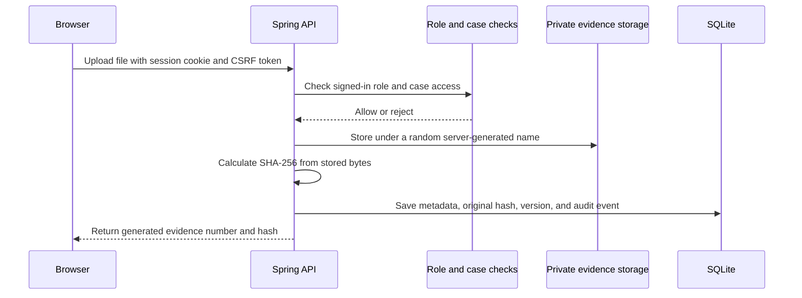

# CyberTrace Viva Guide

## One-minute explanation

CyberTrace is a small evidence-intake and chain-of-custody application. An authorized user uploads a real file. The Spring Boot server stores it privately and calculates SHA-256 from the stored bytes. Later checks hash the stored bytes again and compare them with the authorized version hash. A correction becomes a new version, so the original submission and its reference hash stay in the record. Custody changes only after the selected recipient accepts a transfer. Important actions are appended to a hash-linked audit history.

This is a college prototype, not a certified evidence vault. A database administrator who can rewrite the entire SQLite database can also recompute its audit hashes. The background file checker runs periodically; it is not instant monitoring.

## Source map

| Feature | Main source |
|---|---|
| Application start and scheduled checks | `backend/src/main/java/edu/cybertrace/App.java` |
| HTTP routes, authorization decisions, and workflow endpoints | `backend/src/main/java/edu/cybertrace/Api.java` |
| Password hashing, session security, CSRF, and route protection | `backend/src/main/java/edu/cybertrace/SecurityConfig.java` |
| Enabled-account and current-role checks on existing sessions | `backend/src/main/java/edu/cybertrace/ActiveAccountFilter.java` |
| Approved role names | `backend/src/main/java/edu/cybertrace/RolePolicy.java` |
| Hashing, audit append, and scheduled file-integrity checks | `backend/src/main/java/edu/cybertrace/ForensicsService.java` |
| Database table models | `backend/src/main/java/edu/cybertrace/Records.java` |
| Database queries | `backend/src/main/java/edu/cybertrace/Repositories.java` |
| Failed sign-in and authorization audit events | `backend/src/main/java/edu/cybertrace/SecurityEventLogger.java` |
| One-shot local admin recovery | `backend/src/main/java/edu/cybertrace/LocalAccountRecovery.java` |
| React routes and page components | `frontend/src/ui.tsx` |
| Navigation and visual styles | `frontend/src/style.css` |
| Spring Boot and SQLite settings | `backend/src/main/resources/application.properties` |
| Full workflow and security checks | `backend/src/test/java/edu/cybertrace/CyberTraceWorkflowTest.java` |
| SHA-256 unit checks | `backend/src/test/java/edu/cybertrace/HashingTest.java` |

## Request-to-storage flow

For an integrity check, Spring reads the saved file, calculates its current hash, compares it with the active authorized version hash, and saves a verification result. The original `referenceHash` stays separately preserved. An authorized correction creates a new `EvidenceVersion`; it does not replace the old file.

## How to demonstrate it

Use only a small synthetic file such as `demo-evidence.txt`; do not upload private, personal, or real case data.

1. Start the backend and frontend using the README instructions.
2. On a fresh local database, use the one-time setup key to create the first ADMIN. Do not use a default password; choose a private password for the demonstration.
3. Sign in as ADMIN and create an INVESTIGATOR and a LAWYER from **User & Role Management**. Use temporary demo passwords and share them only with the intended demo users.
4. Create an example case and assign the investigator. Sign in as the lawyer and submit the synthetic file to that case.
5. Open the generated evidence record. Copy the server-created SHA-256 and run **Verify stored file**. It should report `INTACT` and show reference/current hashes.
6. Submit a corrected copy through the version workflow with a reason. Confirm that a new version appears and the original reference hash is unchanged.
7. Ask the investigator to request custody transfer to another investigator. Confirm the custodian remains unchanged while status is `REQUESTED`; sign in as the recipient and accept. The custodian should then change, and both events remain on the timeline.
8. To demonstrate detected tampering safely, first stop the backend and frontend. Restart the backend with a separate throwaway database and evidence directory by setting `CYBERTRACE_DB_PATH` and `CYBERTRACE_STORAGE` to new folders under `backend\target\classroom-demo`. Create the admin and evidence again using synthetic data only. Stop the backend, locate the uniquely named file inside that throwaway evidence directory, and append a short test string to it. Restart and verify the evidence (or wait for the scheduled check). The result should be `MODIFIED`, the original reference hash should remain unchanged, and an authorized private alert should appear. Do not perform this step against the normal `database` or `storage` folders.
9. As ADMIN or AUDITOR, open **Audit Trail** and run **Verify chain**. A fresh chain should be valid. Automated tests also alter an isolated test audit row and confirm the verifier detects the first broken event.

The UI/API reports IDs generated by the current database. Do not assume an evidence ID such as `101`; use the actual ID or evidence number shown in the repository.

## Test summary

The workflow test covers one-time admin bootstrap, public self-registration restrictions, login, protected roles, upload and server SHA-256, intact verification, version/hash preservation, tamper detection, private alerts, case notes, custody acceptance, case-scoped visibility, and audit-chain tamper detection. `HashingTest` checks the hash helper. Run `mvn test` in `backend`; run `npm run build` in `frontend`.

## Limitations to say clearly

- Evidence bytes are stored on the same host disk as the app (or its configured persistent disk); there is no separate immutable/WORM evidence store.
- SQLite audit chaining is tamper-evident for ordinary edits, not proof against a fully privileged operator.
- The automatic filesystem checker runs every 30 seconds after startup; tampering is detected on a scheduled check or a user verification, not instantly.
- There is no MFA, enterprise identity integration, automated external backup, digital signature service, or PDF report export.
- The hosted classroom configuration requires a persistent disk and a connected deployment account. No public deployment URL exists until the owner deploys it.
